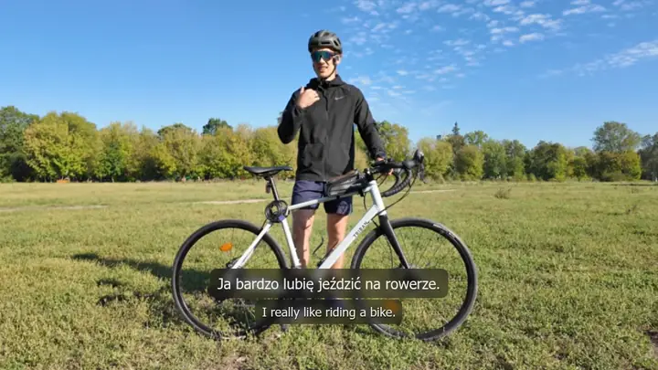

  

<h1 align="center">YouTube Subtitle Translator</h1>

  
  
  

&nbsp;

  
  
  
   
  
  
  
   
  
  
  

&nbsp;

*YouTube Subtitle Translator* is a browser extension to help you learn spoken languages. It displays YouTube caption tracks as interactive subtitles. Hover over or tap a word to translate it using online translation services. English caption translations appear below the original when YouTube makes them available. Note that YouTube videos must have a usable caption track.

Interactive captions start automatically on YouTube watch pages when a non-English video language can be detected and a matching caption track exists. English-language videos do not start the extension's caption acquisition or overlay; YouTube's own captions remain available. Manually authored captions are preferred over automatic captions. The first line uses the detected source language. Already-captured English captions supply the second line when available; otherwise, an existing English track is fetched directly. YouTube auto-translation is used for translatable tracks only when no English track exists. Word lookups also translate into English.

*This demonstration shows an excerpt from [this video](https://www.youtube.com/watch?v=Z9PRhksKFqU&t=85s) - © 2026 [Polish with Kamil](https://www.youtube.com/@polishwithkamil).*

This project began as *Easy Languages Dictionary*, an extension that OCRed the subtitles in videos the of Easy Languages YouTube channels, but has since moved on from this.

### Supported browsers

The extension is available for [Firefox](https://addons.mozilla.org/en-US/firefox/addon/easy-languages-dictionary/) and all Chromium-based browsers that support extensions ([Chrome](https://chromewebstore.google.com/detail/cclabikdbgmiadcihncalbdchliaambo), [MS Edge](https://microsoftedge.microsoft.com/addons/detail/easy-languages-dictionary/polkponobkkpkdjibgiomifmcokdihjl), [Opera](https://chromewebstore.google.com/detail/cclabikdbgmiadcihncalbdchliaambo), ...).

The extension is not available for Safari, for the following reasons:
- Publishing a Safari extension requires enrolling in the 'Apple Developer Program', at a cost of 99 $/year, which I have very little appetite for.
- Safari [doesn't support some WebExtension APIs](https://developer.mozilla.org/en-US/docs/Mozilla/Add-ons/WebExtensions/API/webNavigation/onHistoryStateUpdated#browser_compatibility) which this extension relies on.

## Tests

Run `npm test` for unit tests or `npm run test-coverage` for coverage. Translator
unit tests use mocked service responses and run in CI. Real-service checks are
opt-in via `npm run test-live`; see the [live translator test guide](./__tests__/background/translators/live/README.md).

## License

© R.&thinsp;N. West, 2023-2024. Released under the [GPL](https://www.gnu.org/licenses/old-licenses/gpl-2.0.html) version 2 or greater. This software carries no warranty of any kind. Note that the license only covers the code published in this repository and not any trademarks. If you redistribute the software, modified or unmodified, make sure to change its name and icons so that your derivative cannot be mistaken for the original.
